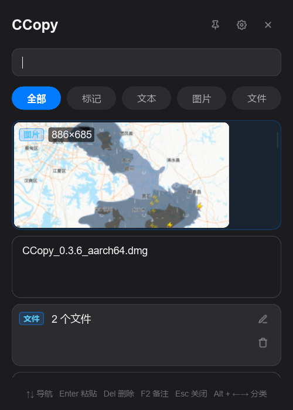
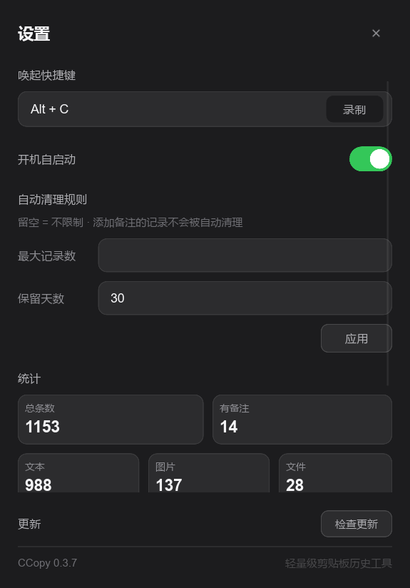

# CCopy

剪贴板历史记录工具，使用 Rust + Slint 开发。

## v0.4.8

- 降低图片历史浏览的内存开销：列表虚拟化，仅保留可视区域附近的缩略图，隐藏面板后释放模型中的图片引用。
- 已有合格缩略图时直接读取 PNG 尺寸信息，避免重复解码完整原图。
- 缩略图后台任务使用单工作线程，搜索和分类重载时淘汰旧任务，翻页时保留前页任务。

## 功能特性

- 📝 **文本历史** - 自动记录所有复制的文本内容
- 🖼️ **图片预览** - 支持图片复制，列表内联缩略图预览（异步加载不卡顿）
- 📁 **文件记录** - 记录复制的文件路径，显示文件名列表与类型标签
- 🔍 **搜索过滤** - 支持关键词搜索历史记录，备注匹配优先显示
- 🏷️ **分类筛选** - 按「全部/文本/图片/文件」快速筛选
- ⌨️ **键盘导航** - 全快捷键操作，无需鼠标
- 🔥 **热重载** - 开发模式下修改 UI 无需重启程序
- 📦 **持久化存储** - 使用 SQLite 保存历史记录，重启不丢失
- 🎯 **光标定位** - Windows 下自动在光标附近弹出窗口
- ⚙️ **设置页** - 可视化配置开机自启、全局热键、自动清理规则
- 📊 **统计面板** - 设置页展示总条数及各分类、备注条数统计
- 🚀 **开机自启** - 支持系统开机自动启动
- 🔄 **更新检查** - 自动检查最新版本（优先 Gitee，失败降级 GitHub，国内访问更顺畅）
- 🗑️ **托盘菜单** - 系统托盘快捷操作
- 📌 **备注标记** - 为任意记录添加备注，有备注的记录不会被自动清理
- 📌 **窗口固钉** - 固钉模式下窗口保持显示，不自动隐藏
- ☁️ **WebDAV 同步** - 支持多设备间剪贴板历史同步（坚果云等标准 WebDAV 服务）

## 同步功能

通过 WebDAV 在多设备间同步剪贴板历史，设置页配置 WebDAV 地址、账号密码后即可使用。

### 同步规则

同步受两个开关控制，组合决定哪些内容会被同步：

| 开关 | 作用 |
|---|---|
| **仅同步标记内容** | 开启后，所有类型（文本/图片/文件）都需有备注才会同步 |
| **同步图片** | 图片是否参与同步的总开关（关闭则图片永不同步） |

各类型内容在不同开关组合下的同步行为：

| 内容类型 | 仅同步标记=开 + 同步图片=开 | 仅同步标记=开 + 同步图片=关 | 仅同步标记=关 + 同步图片=开 | 仅同步标记=关 + 同步图片=关 |
|---|---|---|---|---|
| 文本/文件 | 需有备注 | 需有备注 | 全部同步 | 全部同步 |
| 图片 | 需有备注 | 不同步 | 全部同步 | 不同步 |

> 简单理解：「仅同步标记内容」对所有类型生效；「同步图片」是图片的额外总开关。

### 删除同步

- 本地删除记录会推送删除标记到远端，其他设备同步后也会删除
- 若本地误删，只要远端尚未收到删除标记，重新同步可从远端恢复

### 防回环与冲突

- 采用 LWW（Last Write Wins）策略：按 `updated_at` 时间戳判断，本地较新则跳过远端覆盖
- 同一内容（相同 hash）只保留最新版本，避免循环同步

## 仓库镜像

本仓库同步维护于 GitHub 与 Gitee：

- GitHub：https://github.com/CGodX/CCopy
- Gitee：https://gitee.com/ccgod/CCopy

代码 push 后自动镜像到 Gitee；Release 制品构建完成后自动同步上传到 Gitee Release。应用内更新检查优先走 Gitee，失败降级 GitHub。

## 截图展示





## 快捷键

| 快捷键 | 操作 |
|---|---|
| `Alt + V` | 唤起面板（全局快捷键，可在设置中修改） |
| `↑` / `↓` | 在列表中上下切换选中项 |
| `Alt + ←` / `Alt + →` | 切换分类筛选 |
| `Enter` | 选中当前项并粘贴到原窗口 |
| `Esc` | 关闭面板 |

## 使用说明

1. 复制任意内容（文本、图片、文件）都会自动记录
2. 按下 `Alt + V` 唤起历史面板
3. 使用方向键上下选择，或直接点击项目
4. 按下回车自动粘贴到之前的编辑器
5. 点击项目右侧 × 删除记录
6. 点击项目右侧备注图标可为记录添加备注，有备注的记录不会被自动清理
7. 点击标题栏固钉图标可固定窗口，固定后窗口不自动隐藏
8. 在设置页可配置开机自启、全局热键、自动清理规则，并查看记录统计

## 依赖

- Rust 1.88+
- Slint 1.16.1

## 编译

```bash
cargo build --release
```

## 打包

使用 cargo-packager 生成安装包：

```bash
# Windows NSIS 安装包
cargo packager --release --formats nsis

# macOS DMG
cargo packager --release --formats dmg
```

## 开发

调试模式自动启用 Slint 热重载，修改 `src/ui/main.slint` 后保存即可看到变化：

```bash
cargo run
```

## 项目结构

```
CCopy/
├── src/
│   ├── ui/
│   │   ├── main.slint        # 主界面 UI 定义
│   │   ├── settings.slint    # 设置页 UI 定义
│   │   └── mod.rs            # UI 模块声明
│   ├── main.rs               # 主入口
│   ├── clipboard_history.rs  # 剪贴板监听
│   ├── clipboard_item.rs     # 数据结构
│   ├── storage.rs            # SQLite 存储
│   ├── categories.rs         # 分类逻辑
│   ├── filter.rs             # 搜索过滤
│   ├── platform.rs           # 平台相关（窗口定位、粘贴）
│   ├── hotkey.rs             # 全局热键
│   ├── autostart.rs          # 开机自启
│   ├── settings.rs           # 设置管理
│   ├── updater.rs            # 更新检查
│   ├── tray.rs               # 系统托盘
│   ├── drag.rs               # 窗口拖动
│   └── common.rs             # 公共工具
├── build.rs                  # Slint UI 编译脚本
├── packager/                 # 打包资源（图标、NSI 脚本）
└── Cargo.toml
```
